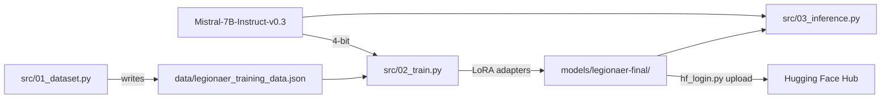

<div align="center">

# Finetune LLM

**Teach Mistral-7B a persona with LoRA: a Roman legionary who explains Scrum**


[](https://colab.research.google.com/github/HuberNicolas/finetune-llm/blob/main/colab_legionaer_finetuning.ipynb)

[Quick start](#quick-start) · [How it works](#how-it-works) · [Documentation](#documentation)

</div>

Finetune LLM is a small learning project for parameter-efficient fine-tuning. It loads
[Mistral-7B-Instruct-v0.3](https://huggingface.co/mistralai/Mistral-7B-Instruct-v0.3) in 4 bit and trains LoRA
adapters on a handful of question–answer pairs, so the model answers questions about Scrum in the voice of
*Marcus Productivus Maximus*, a Roman legionary turned Scrum Master. The persona is the excuse; the point is to go
through the whole loop once: data → training on a free GPU → inference → upload to the Hugging Face Hub.

## Features

- 🧾 **Tiny dataset**: 17 hand-written instruction/answer pairs in German, generated by `src/01_dataset.py`
- ⚡ **QLoRA-style training**: 4-bit NF4 quantisation (bitsandbytes) and LoRA adapters (peft) on the attention
  projections, trained with TRL's `SFTTrainer`; fits on a free T4 GPU
- ⚙️ **One config file**: model, paths, LoRA, training and generation settings in `config.yaml`
- 💬 **Interactive inference**: chat with the fine-tuned model, run a set of test questions, or export the adapters
- ☁️ **Runs on Colab**: a notebook that clones the repository, trains, tests and uploads to the Hugging Face Hub

> [!NOTE]
> Built in July 2026 as a personal experiment to learn LoRA fine-tuning hands-on. Code and documentation are in
> English; the training data and test questions are in German, because the persona answers in German.

## Contents

- [Tech stack](#tech-stack)
- [How it works](#how-it-works)
- [Quick start](#quick-start)
- [Configuration](#configuration)
- [Repository structure](#repository-structure)
- [Development](#development)
- [Documentation](#documentation)
- [Known issues](#known-issues)
- [License](#license)
- [Author](#author)

## Tech stack

| Area | Technologies |
|---|---|
| Model |  |
| Training |      |
| Environment |     |

## How it works



1. **Data**: each example is an `instruction` (a question about Scrum) and an `output` (the legionary's answer),
   formatted as `[INST] question [/INST] answer </s>`.
2. **Load**: the base model is loaded in 4 bit, so its ~14 GB of weights fit into a few GB of VRAM.
3. **Adapt**: LoRA adds two small matrices (rank 16) next to the frozen query and value projections; only these are
   trained, well under 1 % of the parameters.
4. **Train**: 3 epochs, effective batch size 8, learning rate 2e-4.
5. **Use**: `03_inference.py` loads the base model, puts the adapters on top and generates answers.

Example answer to *"Was ist ein Sprint?"* from the training data:

> Hark! Ein Sprint, mein Freund, ist wie ein Feldzug unserer Legionen! […] Für Rom! ⚔️

Details: [docs/training.md](docs/training.md).

## Quick start

### Google Colab (recommended)

Open the [notebook](colab_legionaer_finetuning.ipynb) with the badge above, switch the runtime to a **T4 GPU** and
run the cells from top to bottom. Training takes about 20–30 minutes. See [docs/colab.md](docs/colab.md).

### Local

Requires Linux or Windows, an NVIDIA GPU with about 16 GB of VRAM and [Pixi](https://pixi.sh/).

1. Install the environment and activate it:

   ```bash
   pixi install
   ```

   ```bash
   pixi shell
   ```

2. Create the folders and `.env`:

   ```bash
   make setup
   ```

3. Write the training data:

   ```bash
   python src/01_dataset.py
   ```

4. Train the adapters (saved to `models/legionaer-final/`):

   ```bash
   python src/02_train.py
   ```

5. Chat with the model, run the test questions or export the adapters:

   ```bash
   python src/03_inference.py
   ```

6. Optional: upload the adapters to the Hugging Face Hub (see [docs/hugging-face-hub.md](docs/hugging-face-hub.md)):

   ```bash
   python hf_login.py upload
   ```

`start_training.sh` runs steps 3–5 in a row.

## Configuration

All settings are in [`config.yaml`](config.yaml):

| Setting | Default |
|---|---|
| Base model | `mistralai/Mistral-7B-Instruct-v0.3` |
| Quantisation | 4 bit, NF4, double quantisation |
| LoRA rank / alpha / dropout | 16 / 32 / 0.05, on `q_proj` and `v_proj` |
| Epochs / batch size / gradient accumulation | 3 / 4 / 2 |
| Learning rate / warm-up / weight decay | 2e-4 / 10 % / 0.01 |
| Generation | 256 new tokens, temperature 0.7, top-p 0.9 |

[`.env`](.env.example) only holds the optional `HF_TOKEN` for the upload. The full reference is in
[docs/training.md](docs/training.md#configuration).

## Repository structure

| Path | Content |
|---|---|
| [`src/`](src) | `01_dataset.py` (training data), `02_train.py` (fine-tuning), `03_inference.py` (chat, tests, export) |
| [`data/`](data) | `legionaer_training_data.json`, the 17 training examples |
| [`colab_legionaer_finetuning.ipynb`](colab_legionaer_finetuning.ipynb) | End-to-end run on Google Colab |
| [`config.yaml`](config.yaml) | All settings |
| [`hf_login.py`](hf_login.py) | Hugging Face login and upload |
| [`scripts/`](scripts) | `setup_project.py` (folders and `.env`) |
| [`docs/`](docs) | Guides |
| `pixi.toml`, `pixi.lock`, `requirements-kaggle.txt` | Environment for Pixi and for Colab/Kaggle |
| `Makefile`, `start_training.sh` | Shortcuts |

Trained models go to `models/` (ignored by Git): checkpoints in `legionaer-sft/`, the final adapters in
`legionaer-final/`, the export in `legionaer-deployed/`.

## Development

| Task | Command / guide |
|---|---|
| Lint and check formatting | `make lint` |
| Fix and format | `uvx ruff check --fix .` and `uvx ruff format .` |
| All `make` targets | `make help` |
| Environment, CI, where to change what | [docs/development.md](docs/development.md) |

## Documentation

| Guide | Content |
|---|---|
| [docs/training.md](docs/training.md) | Pipeline, LoRA, data format, every setting, training your own persona |
| [docs/colab.md](docs/colab.md) | Google Colab, Kaggle, saving notebook changes to GitHub |
| [docs/hugging-face-hub.md](docs/hugging-face-hub.md) | Uploading the adapters and loading them from the Hub |
| [docs/development.md](docs/development.md) | Environment, linting, CI, smoke test without a GPU |
| [docs/troubleshooting.md](docs/troubleshooting.md) | GPU, memory, installation and upload problems |

## Known issues

- **No full training run with the current code.** The code was adapted to the APIs of trl 1.x and transformers 5.x
  and checked end to end on a CPU with a tiny test model (see [docs/development.md](docs/development.md)), but not
  trained on a GPU with Mistral-7B since.
- **Very small dataset.** 17 examples teach the tone only roughly; expect answers that mix the persona with the normal
  assistant style.
- **No Pixi environment for macOS**, since bitsandbytes training needs CUDA.

## License

The code is released under the [MIT License](LICENSE). The base model
[Mistral-7B-Instruct-v0.3](https://huggingface.co/mistralai/Mistral-7B-Instruct-v0.3) is published by Mistral AI under
the Apache 2.0 license and is not part of this repository.

## Author

Nicolas Huber ([@HuberNicolas](https://github.com/HuberNicolas)), personal project, 2026.
