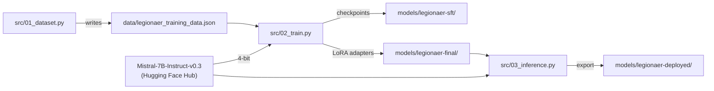

# Training

How [`src/02_train.py`](../src/02_train.py) turns Mistral-7B into the legionary Scrum Master, and how to change it.

## Pipeline



1. **Data**: `01_dataset.py` writes the examples from its `TRAINING_DATA` list to JSON.
2. **Load**: the base model is loaded with bitsandbytes in 4 bit (NF4, double quantisation), so its ~14 GB of
   float16 weights fit into a few GB of VRAM.
3. **Adapt**: peft adds LoRA adapters next to the frozen query, key, value and output projections of every attention layer.
   Only the adapters are trained, well under 1 % of the parameters.
4. **Train**: TRL's `SFTTrainer` runs supervised fine-tuning on the formatted examples. Short examples are packed into
   longer sequences.
5. **Save**: only the adapters are saved (a few MB), not the base model.

## LoRA in one paragraph

A linear layer computes `W·x` with a large weight matrix `W` (4096 × 4096 for the attention projections in
Mistral-7B, ~16.8M values). LoRA keeps `W` frozen and learns a low-rank update `B·A`, with `A` of size 16 × 4096 and
`B` of size 4096 × 16 (rank 16): ~131K values per layer. The layer then computes `W·x + (alpha / rank)·B·A·x`.
See the [LoRA paper](https://arxiv.org/abs/2106.09685) and, for LoRA on a 4-bit model, the
[QLoRA paper](https://arxiv.org/abs/2305.14314).

## Data format

[`data/legionaer_training_data.json`](../data/legionaer_training_data.json) is a list of objects:

```json
{
  "instruction": "Was ist ein Sprint?",
  "output": "Hark! Ein Sprint, mein Freund, ist wie ein Feldzug unserer Legionen! …"
}
```

For training, each pair becomes one text in the Mistral instruction format. The tokenizer adds the `<s>` (BOS) token
in front:

```text
[INST] Was ist ein Sprint? [/INST] Hark! Ein Sprint, mein Freund, … </s>
```

Inference uses the same format without the answer, `[INST] {question} [/INST]`, and decodes only the generated tokens.

## Configuration

All settings are in [`config.yaml`](../config.yaml). Paths are relative to the repository root.

| Section | Key | Default | Meaning |
|---|---|---|---|
| `model` | `base_model_id` | `mistralai/Mistral-7B-Instruct-v0.3` | Base model on the Hugging Face Hub |
| `paths` | `dataset` | `data/legionaer_training_data.json` | Training data |
| | `checkpoints` | `models/legionaer-sft` | Training checkpoints |
| | `lora_adapter` | `models/legionaer-final` | Final adapters, read by inference and upload |
| | `export` | `models/legionaer-deployed` | Export from `03_inference.py` (option 3) |
| `quantization` | `use_4bit` | `true` | 4 bit: ~4–5 GB VRAM; `false`: float16, ~15 GB |
| | `quant_type` | `nf4` | 4-bit data type |
| | `double_quant` | `true` | Also quantise the quantisation constants (training) |
| `lora` | `rank` | `16` | Width of the adapter matrices |
| | `alpha` | `32` | Scaling factor, usually 2 × rank |
| | `dropout` | `0.05` | Dropout on the adapters |
| | `target_modules` | `[q_proj, k_proj, v_proj, o_proj]` | Layers that get adapters |
| `training` | `num_epochs` | `5` | Passes over the data |
| | `batch_size` | `4` | Examples per GPU step |
| | `gradient_accumulation_steps` | `1` | Effective batch size = 4 × 1 = 4 |
| | `learning_rate` | `0.0002` | |
| | `warmup_ratio` | `0.1` | Warm-up over the first 10 % of the steps |
| | `weight_decay` | `0.01` | |
| | `max_seq_length` | `512` | Maximum tokens per sequence |
| | `packing` | `false` | Pack short examples into one sequence (fewer, longer steps) |
| | `optimizer` | `paged_adamw_32bit` | Paged AdamW from bitsandbytes (saves memory) |
| | `save_steps`, `logging_steps`, `save_total_limit` | `100`, `5`, `3` | Checkpoints and logging |
| `inference` | `max_new_tokens` | `256` | Maximum answer length |
| | `temperature` | `0.7` | 0 = deterministic, 1 = creative |
| | `top_p` | `0.9` | Nucleus sampling |

The base model must use the Mistral `[INST]` prompt format; for other model families, change the format in
`load_dataset()` (training) and `generate_answer()` (inference) as well.

With 119 examples and a batch size of 4, an epoch is 30 optimiser steps, about 150 in total; a checkpoint is written
after step 100 and the final adapters after training. Keep an eye on the number of steps when you change the data:
with 17 examples, packing and an effective batch size of 8, an earlier version made only about three optimiser steps
in total and the model did not pick up the persona at all.

## Train your own persona

1. Replace the examples in `TRAINING_DATA` in [`src/01_dataset.py`](../src/01_dataset.py). More and more varied
   examples help more than more epochs; a few dozen to a few hundred are a good range.
2. Run `python src/01_dataset.py`.
3. Adjust the test questions in `run_test_questions()` in [`src/03_inference.py`](../src/03_inference.py).
4. Optionally change `paths` in `config.yaml` (and `repo_name` in [`hf_login.py`](../hf_login.py)) so the new model
   does not overwrite the old one.
5. Train and test as in the [README](../README.md#quick-start).
